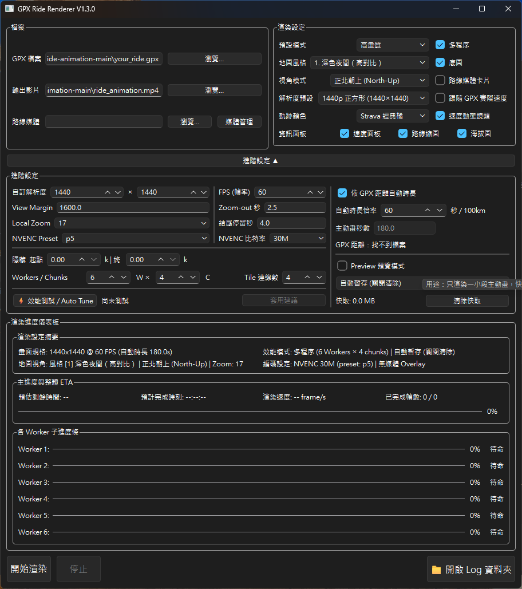

# GPX Ride Renderer

這是 [shao0927/gpx-ride-animation](https://github.com/shao0927/gpx-ride-animation) 的 Windows 強化版，可將 GPX 騎乘紀錄轉成高品質動態地圖影片。此版本導入 PySide6 (Qt) 現代圖形介面、3D 地形透視、動態運鏡、原生零拷貝（Zero-Copy）渲染管線、多程序並行渲染、Workers Auto Tune 自動效能基準測試、NVIDIA NVENC 硬體加速、路線照片/影片 EXIF 智慧匹配與時間軸編輯器、全路線圖資預載與智慧快取管理，並提供 Windows 一鍵可攜式 EXE 打包。

---

## 專案簡介與架構摘要

本專案採 **PySide6 GUI 圖形介面與核心渲染引擎完全解耦** 的模組化架構：

- **進入點 (`GPX_Ride_Renderer.py`)**：負責轉接 CLI、PySide6 GUI 啟動與多程序 Worker 任務派發。
- **核心套件 (`gpx_renderer/`)**：
  - **`config.py`**：全域設定、地圖風格 (`MAP_STYLE_OPTIONS`)、3D 視角參數與動態配置快照。
  - **`core/`**：
    - `data.py`：GPX 數據解析、`RideData` 結構、平滑內插與地理數據計算。
    - `map_utils.py`：底圖下載 (contextily)、全路線圖資預載引擎 (Pre-fetching Engine) 與區域增量快取。
    - `dem_utils.py`：3D 數位高程模型 (DEM) 下載、高度網格建構與快取。
    - `terrain_3d.py`：3D 地形網格投影、高程立體誇大與 3D 視角透視轉換。
    - `encoder.py`：FFmpeg / NVIDIA NVENC 硬體編碼器探測、影片分塊與無損合併。
    - `media.py`：相片/影片 EXIF 拍攝時間與 GPS 座標匹配、縮圖快取與自訂時間偏移。
    - `cache_manager.py`：Session 快取與 Persistent 永久磁碟快取管理（內建 LRU 容量自動修剪機制）。
    - `parallel.py`：多程序動態分塊並行渲染引擎與 Workers Auto Tune 效能測試。
    - `renderer.py`：`RideRenderer` 零拷貝畫格繪製引擎（包含 HUD 速度錶、小地圖、海拔高度剖面圖、媒體彈跳卡片與結尾騎乘統計）。
  - **`gui/`**：
    - `qt_app.py`：PySide6 主視窗應用程式、即時進度監控、設定持久化與渲染子程序管理。
    - `qt_media_dialog.py`：專屬路線媒體管理視窗（地圖與表格即時聯動、縮圖預覽、時間偏移微調與 EXIF 覆寫）。
    - `main_window.ui` & `ui_main_window.py`：Qt Designer 視覺化介面設定與編譯模組。
  - **`utils/`**：`env.py` (UTF-8 stdio、Windows 隱藏控制台視窗、字型動態載入) 與 `config_io.py` (JSON 設定讀寫)。

---

## 核心功能亮點

- **現代化 PySide6 圖形介面**：清晰直覺的參數配置介面，支援多種解析度預設（1080p 直式/橫式/正方形、2K、IG 貼文格式或自訂）。
- **3D 地形透視與多模式運鏡**：
  - **3D-Terrain（3D 地形透視）**：結合 DEM 數位高程模型與衛星地圖，支援自然鳥瞰俯角、地形高度微誇大與 2D/3D 滑順過渡運鏡。
  - **Heading-Up（跟隨行進方向）**：智慧跟隨行駛方向平滑旋轉，內建最大轉速限制避免過彎暈眩。
  - **North-Up（正北朝上）**：經典固定正北視角。
- **速度動態鏡頭縮放（Dynamic Speed Zoom）**：低速爬坡自動推近特寫，高速衝刺自動拉遠展示開闊視野，搭配 IIR 指數平滑濾波消除抖動。
- **極致渲染效能（Zero-Copy Pipeline）**：
  - 全路線圖資預載引擎（Pre-fetching Engine）：主程序預先下載底圖與 DEM，消除多程序伺服器限流與卡死。
  - 原生零拷貝渲染：全面採用 NumPy / OpenCV 陣列切片與 Alpha 權重融合，效能提升數十倍。
  - 多程序動態分塊渲染（Parallel Rendering）與 **Workers Auto Tune** 自動效能基準測試。
- **硬體編碼加速**：支援 NVIDIA NVENC 硬體編碼加速，環境不支援時自動平滑回退至 CPU libx264。
- **路線媒體相片 / 影片整合**：
  - 自動讀取照片/影片 EXIF 拍攝時間與 GPS 座標，精準對齊路線里程與時序。
  - 專屬獨立媒體管理視窗：地圖標記與表格雙向聯動、縮圖預覽快取、彈出秒數與時間偏差微調。
  - 支援真實速度（Real Speed）播放模式。
- **多元地圖風格與自訂外觀**：
  - 支援「深色夜間」、「全彩導航」、「簡約淺灰」、「衛星影像」、「戶外等高線 (Strava 風格 / OpenTopoMap)」與「山岳地形 (Google Terrain)」。
  - 軌跡風格多種配色（Strava 經典橘、速度漸層、螢光綠、電光藍、熾熱紅等）。
- **自訂 HUD 資訊面板**：左上角速度面板、右上角路線縮圖與底部高度剖面圖皆支援等比例自適應縮放與獨立開關。
- **隱私起終點裁切**：支援自訂隱藏起點/終點指定里程範圍（Privacy Masking）。
- **結尾動畫與騎乘統計**：全路線平滑 Zoom-Out 俯瞰總覽，並於結尾呈現總距離、爬升、均速、極速、總耗時與移動時間等完整 RIDE STATS 數據卡片。
- **綠色可攜式 EXE**：提供 Windows 獨立壓縮包，免安裝 Python 與 FFmpeg 即可開箱即用。

---

## 畫面預覽



---

## 專案內容與目錄結構

```text
GPX_Ride_Renderer.py                 主程式進入點 (GUI / CLI / Subprocess 任務分派)
GPX_Ride_Renderer.spec               PyInstaller 打包規格檔
build_exe.py                         一鍵 EXE 打包與自動壓縮建置腳本
build_exe.bat                        Windows 快速打包批次檔
publish_release.py                   GitHub Releases 自動發布工具
requirements-build.txt               執行與打包相依套件清單
run_source.bat                       從原始碼快速啟動腳本
gpx_renderer/                        核心模組套件
├── __init__.py                      套件初始化與版本號定義 (__version__)
├── config.py                        全域參數、地圖風格、運鏡與動態設定
├── core/                            核心渲染與平行處理引擎
│   ├── cache_manager.py             Session / Persistent 磁碟快取與 LRU 管理
│   ├── data.py                      GPX 數據解析、距離計算與軌跡數學
│   ├── dem_utils.py                 3D DEM 數位高程模型下載與網格快取
│   ├── encoder.py                   FFmpeg / NVENC 編碼器探測與影片合併
│   ├── map_utils.py                 地圖下載、全路線預載引擎與增量快取
│   ├── media.py                     相片/影片 EXIF 解析、GPS 匹配與縮圖快取
│   ├── parallel.py                  多程序動態分塊並行渲染與 Auto Tune
│   ├── renderer.py                  RideRenderer 零拷貝畫格繪製引擎 (HUD / 媒體卡片 / 結尾總覽)
│   └── terrain_3d.py                3D 地形投影、立體高程放大與透視鏡頭
├── gui/                             PySide6 (Qt) 圖形介面
│   ├── __init__.py                  GUI 介面啟動函式
│   ├── main_window.ui               Qt Designer 主介面佈局檔
│   ├── ui_main_window.py            編譯後之 Qt 主介面代碼
│   ├── qt_app.py                    PySide6 主視窗控制、渲染監控與設定同步
│   └── qt_media_dialog.py           路線媒體管理視窗 (地圖聯動與 EXIF 覆寫)
└── utils/                           共用工具函式
    ├── config_io.py                 JSON 設定檔讀寫
    └── env.py                       環境編碼、Windows 控制台隱藏與動態字型處理
```

---

## 下載與安裝

儲存庫只保留原始碼與建置腳本，不包含大型編譯產物。若只想直接使用程式：

👉 請前往 [GitHub Releases](https://github.com/ccccchhhheeenng/gpx-ride-animation/releases/latest) 下載最新版 `GPX_Ride_Renderer_vX.X.X_windows_x64.zip`，解壓縮後直接執行 `GPX_Ride_Renderer.exe` 即可使用。

---

## 從原始碼執行

需要 64 位元 **Python 3.10** 或更新版本。

### 1. 安裝相依套件

```powershell
python -m pip install -r requirements-build.txt
```

### 2. 啟動主程式

```powershell
# 透過批次檔啟動
run_source.bat

# 或直接執行 Python 模組
python GPX_Ride_Renderer.py
```

---

## 重新打包 EXE

專案已內建完整的一鍵打包與發布流程：

```powershell
# 執行打包批次檔 (或 python build_exe.py)
build_exe.bat
```

打包完成後，將自動產出：
1. `../gpx-ride-animation-releases/GPX_Ride_Renderer/`（已隨附 `ffmpeg.exe` 的獨立執行資料夾）
2. `../gpx-ride-animation-releases/GPX_Ride_Renderer_v<version>_windows_x64.zip`（發行壓縮包）

若需發布至 GitHub Releases，請於打包測試無誤後執行：

```powershell
python publish_release.py
```

---

## 上游與授權

本專案衍生自 [shao0927/gpx-ride-animation](https://github.com/shao0927/gpx-ride-animation)，並已取得原作者同意進行衍生開發與功能擴充。原始程式權利仍屬原作者所有。
